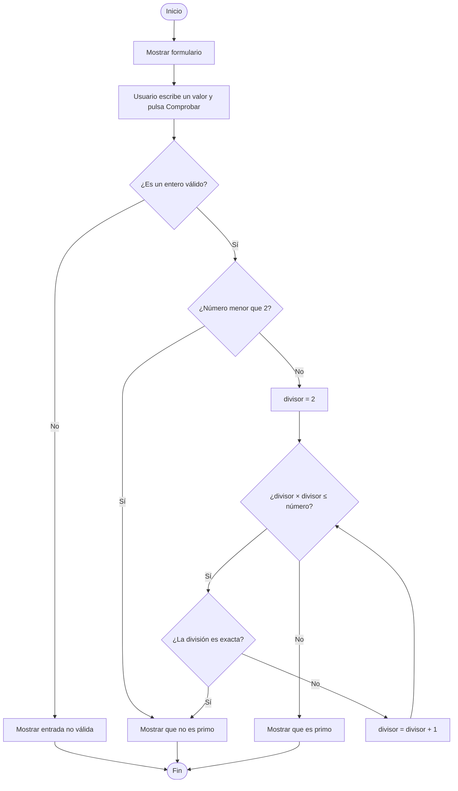

# Identificador de números primos

Aplicativo web hecho con Python y Streamlit que permite ingresar un número entero y comprobar si es primo. Al pulsar **Comprobar**, el aplicativo valida la entrada y muestra el resultado en pantalla: indica si el número es primo o no. Si se ingresa texto vacío, decimal o contenido que no sea un entero, informa que la entrada no es válida.

## ¿Qué considera el aplicativo un número primo?

Un número primo es un entero mayor que 1 que solo tiene dos divisores positivos: 1 y él mismo. Por eso, los números negativos, el 0 y el 1 no son primos.

Para comprobar un número, el programa prueba divisores desde 2 mientras el cuadrado del divisor no supere al número. Si encuentra una división exacta, el número no es primo. Si termina las comprobaciones sin encontrar divisores, es primo. Este método evita probar divisores innecesarios por encima de la raíz cuadrada del número.

## Seudocódigo

```text
INICIO
    mostrar título, explicación y formulario
    pedir al usuario un número entero

    CUANDO el usuario pulse «Comprobar»:
        intentar convertir la entrada a entero

        SI la conversión falla:
            mostrar «Entrada no válida»
        SI NO:
            SI número < 2:
                mostrar «No es primo»
            SI NO:
                divisor ← 2
                es_primo ← VERDADERO

                MIENTRAS divisor × divisor ≤ número:
                    SI número módulo divisor = 0:
                        es_primo ← FALSO
                        terminar las comprobaciones
                    divisor ← divisor + 1

                SI es_primo:
                    mostrar «Es un número primo»
                SI NO:
                    mostrar «No es un número primo»
FIN
```

## Diagrama de flujo



El ciclo comprueba divisores sucesivos. Si alguno divide el número exactamente, termina con resultado no primo; si supera la raíz cuadrada sin encontrar divisor, el número es primo.

## Ejecutar en local

Se recomienda usar Python 3.9 o posterior.

```bash
python -m venv .venv
```

Activa el entorno virtual y luego instala las dependencias e inicia la aplicación:

```bash
pip install -r requirements.txt
streamlit run identificar_primos.py
```

En Windows, activa el entorno con `.venv\Scripts\activate`; en macOS o Linux, con `source .venv/bin/activate`.

## Publicar con GitHub y Streamlit Community Cloud

1. Sube `identificar_primos.py`, `requirements.txt` y este `README.md` a un repositorio de GitHub.
2. Inicia sesión en [Streamlit Community Cloud](https://share.streamlit.io/) con GitHub y autoriza el acceso al repositorio.
3. Crea una aplicación nueva, selecciona el repositorio y la rama, y establece `identificar_primos.py` como archivo principal.
4. Pulsa **Deploy**. Streamlit Cloud instalará las dependencias declaradas en `requirements.txt`.

Cada actualización que subas a la rama seleccionada se podrá publicar desde la misma aplicación.
